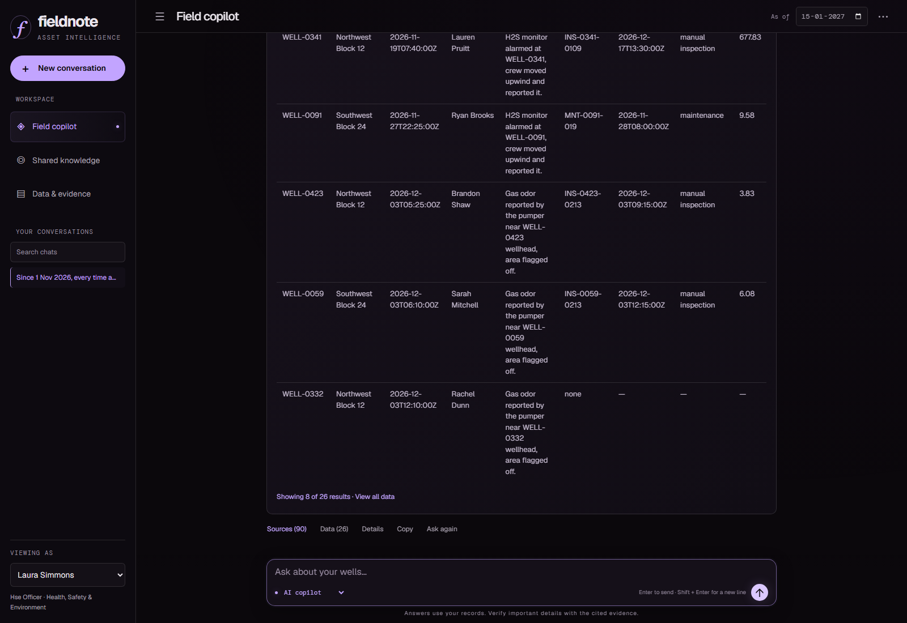

# Fieldnote · Asset Intelligence Copilot

**Ask an operational question. Get an answer you can trace to the original records.**

Built for the **FlytBase Asset Intelligence challenge**. Fieldnote combines well inspections, maintenance records, operator notes and operating procedures to answer questions about current status, compliance, equipment recalls and repair priorities.

**Final dataset:** 600 wells · 125,198 inspections · 17,415 maintenance records

**Analysis date:** 15 January 2027

## Submission — start here

- **[Read the report — Google Drive PDF](https://drive.google.com/file/d/14wU-5seYy1qZEx9ZiksXJH48fIl1EzuE/view)**

  Three pages: system design, architecture and tools on page 1; results and output excerpts for all 11 final questions on pages 2–3.
- **[Watch the demo — Google Drive video, 4:48](https://drive.google.com/file/d/1lGxYIb0J29DRsHg837vK2V_WTb-8EF2a/view)**

  Two minutes explaining the architecture, followed by an actual end-to-end gas-response audit. The recording uses disclosed synthetic narration and explicitly selected Local analysis mode.

Both links allow **Anyone with the link → Viewer** access and were verified while signed out.

## The problem

A well's inspection, latest operator note, repair history and applicable rule can disagree or live in different documents. A useful answer must determine which evidence applies, respect its date, and explain the decision.

Fieldnote helps a reviewer:

- **Resolve current status:** compare corrected inspections with timestamped shut-in and restart notes.
- **Audit compliance:** apply dated gas-response deadlines, bypass approvals and spill requirements.
- **Track recalled equipment:** identify documented installed pump lots and distinguish direct replacement reports from unconfirmed hearsay.
- **Prioritize field work:** rank evidence-backed concerns, with the reasoning and operator quotes visible.
- **Continue a conversation:** return to an earlier result set across topic changes while keeping user preferences private.

## How it works

1. **Load the evidence.** Node.js ingests JSON/JSONL records and source documents into SQLite with FTS5 search. Revised snapshots supersede changed records while retaining provenance.
2. **Interpret the question.** In AI mode, Gemma 4 proposes a structured plan. The application checks dates, well IDs, scope and supported operations; recognized domain rules constrain execution.
3. **Calculate the answer.** Deterministic tools join records and apply the relevant procedures. Numerical results come from these tools, rather than free-form model estimates.
4. **Show the result and its sources.** The browser renders cards, tables, charts or maps. **Sources** opens original evidence, **Data** exposes complete result rows, and **Details** explains execution.
5. **Keep appropriate memory.** Shared field reports retain attribution and verification status. Conversation history and display preferences are stored per user.

**Stack:** Node.js 24 · SQLite / FTS5 · JavaScript browser UI · Gemma `gemma-4-26b-a4b-it` through Google's Gemini API · Playwright verification.

For implementation details, see [Architecture](docs/ARCHITECTURE.md).

## Run locally

Requires **Node.js 24+** and **Git**. The application has no runtime npm dependencies.

```sh
git clone https://github.com/shiv-69-debug/fieldnote-asset-copilot.git
cd fieldnote-asset-copilot
npm run setup:data
npm run start:final
```

Open **http://127.0.0.1:3100**.

`start:final` loads both organizer snapshots with revision handling and fixes the analysis date at **15 January 2027**. Confirm that the interface shows **600 wells**. Dataset files are downloaded separately; no existing local database is needed.

### Choose a reasoning mode

**Local analysis:** select this below the composer to run supported domain questions without an API key. It uses the local parser and deterministic tools.

**AI copilot:** create a `.env` file in the repository root with:

```dotenv
GEMINI_API_KEY=your_key_here
COPILOT_MODEL=gemma-4-26b-a4b-it
```

Restart the server and select **AI copilot**. Credentials stay server-side. Provider failures are explicitly labeled when a supported local fallback is used; a configured key does not guarantee provider availability.

## Try the demonstrated scenario

Select **Laura Simmons**, start a new conversation, choose **Local analysis**, and ask:

> Since 1 Nov 2026, every time an operator note reports gas at a well, did we get someone out to that well in time under our operating procedures? List every report and whether the response met the deadline.

The verified run returned **26 reports: 17 met the deadline and 9 missed it**.

1. Inspect the report and response timestamps in the table.
2. Open **Data** and filter for `Missed`.
3. Open **Sources** to inspect an operator note and the operations SOP.
4. Open **Details** to see the execution plan and analysis period.

The key rule is temporal: **24 hours before 1 January 2027; 12 hours from that date**. Only a later maintenance start or manual inspection on the same well qualifies.



*Actual application screenshot from the saved final-question browser replay.*

## Verification

The saved final evaluation completed **all 21 turns of the 11 final questions**, using their specified users and sessions through the browser. That replay recorded **18 model-backed read turns, 3 local memory writes and 0 provider fallbacks**. The separate narrated demo is a fresh Local analysis run.

Reproduce the final source/rule checks:

```sh
npm run evaluate:final
```

For the unit/API and browser regression suites:

```sh
npm ci
npm test
npx playwright install chromium
npm run test:browser
```

The checks test application behavior; they are **not an independent official answer key**. Some final questions require judgement or deliberately lack measurements.

## Reading the code

- `server.js` — HTTP API and application startup.
- `src/store.js` — records, search, snapshot revisions and persistence.
- `src/planner.js` — model planning, local routing and constraints.
- `src/engine.js` and `src/field-operations.js` — calculations and operational rules.
- `src/service.js` — conversations, references, feedback and preferences.
- `public/` — chat interface and evidence/data/details panels.
- `tests/` and `e2e/` — automated checks and browser scenarios.

## Interpretation and limits

- Missing reservoir pressure, metered oil output or incident-specific H2S values are reported as **unavailable**.
- Repair priorities are **transparent heuristics**, not calibrated failure probabilities.
- Recall counts cover **documented affected inventory**; missing lot evidence does not prove a pump is unaffected.
- Temperature comparisons state their period, operating-state filter and ambient/type/month normalization.
- This is a local challenge application. Its user selector demonstrates per-user state; it is not production authentication.

## Participation certificate

Certificate awarded to **Shivmurti Doddini** for participation in **AI Hackers Collective × Hacktoberfest Hack Day**, held on **17 October 2026** at **FlytBase Labs & online**.

[](docs/participation-certificate.png)

## License and attribution

Application: [MIT](LICENSE). Dataset and fictional operating documents: [FlytBaseAILabs](https://github.com/FlytBaseAILabs/flytbase-ahc-swe-asset-intelligence-dataset), © 2026 FlytBase, MIT. Dataset downloads retain their original license. Map tiles: OpenStreetMap contributors. Browser tooling: Playwright, Apache-2.0.

Development was AI-assisted using OpenCode. No model training or image analysis is performed.
