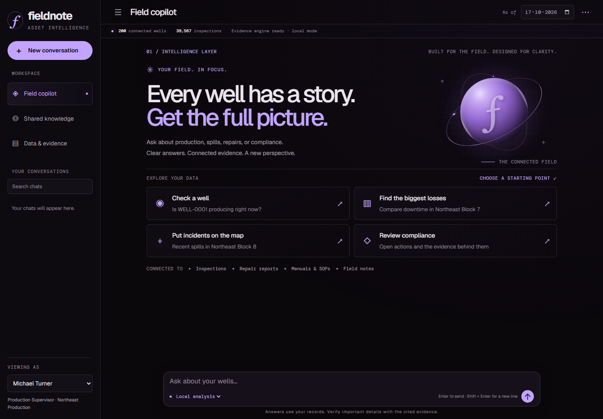
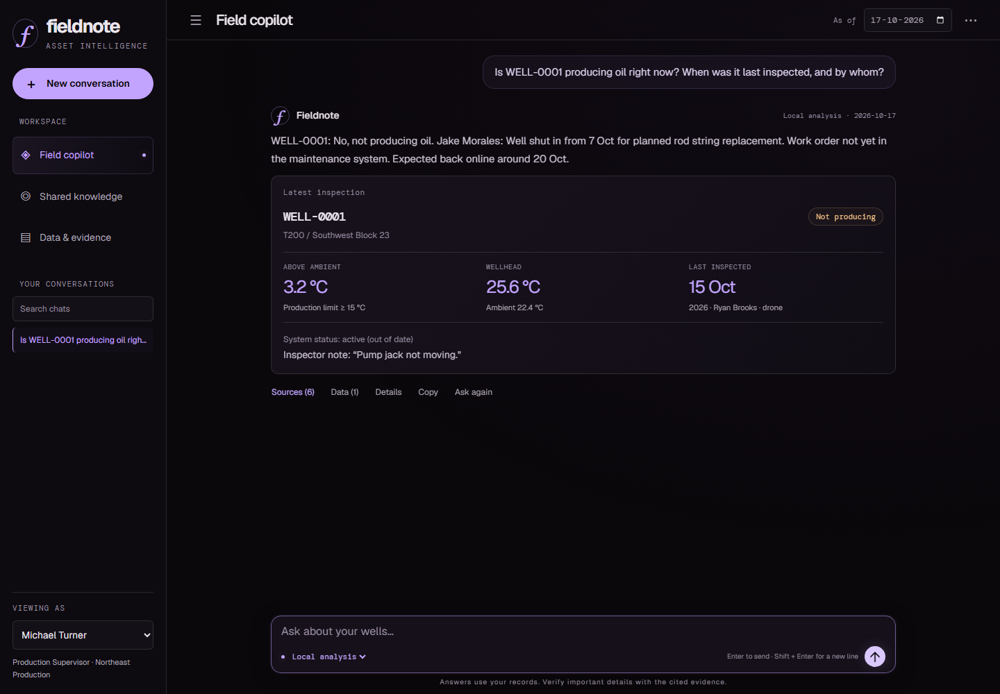

# Fieldnote · Asset Intelligence Copilot

**Ask your oil field a question. Inspect the records behind the answer.**

Built for the FlytBase Asset Intelligence local challenge. Fieldnote combines a model-backed chat interface, deterministic engineering calculations, original-source citations, and persistent shared/private memory.

The futuristic interface takes its near-black/lavender palette, editorial typography, and orbital visual language from [Shivmurti's portfolio](https://shiv-69-debug.github.io/shivmurti-portfolio/). Motion respects reduced-motion preferences, and every chart retains an accessible data table.

The conversation layout keeps summaries and visuals inline, with **Sources**, **Data**, and **Details** panels for deeper inspection. The sidebar collapses, large data tables are filterable/paginated, and **Latest** returns to the newest reply without forcing a scroll while you read older messages.



## Final submission files

- [Three-page final report (PDF)](docs/final-submission.pdf) — page 1: architecture and tools; pages 2–3: results and output excerpts for all 11 final questions.
- [Narrated demo video (MP4, 4:48)](https://github.com/shiv-69-debug/fieldnote-asset-copilot/releases/download/final-submission-v2/Fieldnote-demo.mp4) — synthetic narration, two-minute architecture explanation, then a fresh end-to-end gas audit in explicit Local analysis mode.
- [Report HTML source](docs/final-submission.html)
- [All 11 final questions: complete answers and visuals](results/final-transcript.html) — download and open locally, keeping `results/final-browser/` alongside it for screenshots.
- [Concise final results](results/final-summary.md)
- [Recorded browser evaluation](results/final-browser-evaluation.json)
- [Demo notes and optional own-voice recording guide](docs/DEMO.md)

## Run: final 600-well dataset

Requires **Node.js 24+** and Git. There are no runtime npm dependencies.

```sh
git clone https://github.com/shiv-69-debug/fieldnote-asset-copilot.git
cd fieldnote-asset-copilot
npm run setup:data
npm run start:final
```

Open **http://127.0.0.1:3100**. `start:final` explicitly imports both dataset snapshots with revision handling and sets the analysis date to **15 January 2027**. This works without a pre-existing local database. For model-backed answers, create `.env` using `.env.example` and supply your own API key. Without a key, use Local analysis.

To reproduce the final source/rule checks, run `npm run evaluate:final`. To regenerate the report from saved browser evidence, run `npm ci`, `npx playwright install chromium`, then `npm run submission:final`. The recorded final run completed 21 turns; its results are application checks, not an official answer key.

### Original sample dataset

Requires **Node.js 24+** and Git. There are no runtime npm dependencies.

```sh
npm run setup:data
npm start
```

Open **http://127.0.0.1:3100**. In this workspace the already-downloaded dataset under `../.cache/asset-intelligence-dataset/sample-data` is detected automatically. A fresh checkout uses `data/sample-data`, downloaded by `setup:data`.

For AI mode, create `.env` from `.env.example` and set `GEMINI_API_KEY`, or an OpenAI-compatible endpoint and key. This workspace also loads the existing parent `.env`; credentials stay server-side. The default model is `gemma-4-26b-a4b-it`.

```dotenv
GEMINI_API_KEY=your_key
COPILOT_MODEL=gemma-4-26b-a4b-it
ASSET_PORT=3100
ANALYSIS_DATE=2026-10-17
```

Select **AI copilot** below the composer. **Local analysis** uses a limited domain-language parser without inference. Provider failures can fall back to supported local operations or exact retrieved SOP clauses; the answer visibly identifies the fallback and records the error. Novel statistical queries require a working model.

Seeing an HTTP 500 fallback? Read [the provider investigation and how answers are produced](docs/PROVIDER_DIAGNOSIS.md). The UI's `Model configured` label indicates a configured key, not a live availability check.

## What works

- Status cards, tables, temperature line charts, comparison bars, real-coordinate maps, and area/month heatmaps, generated inline for the question. Explicit visual requests take precedence.
- Production derived from each well-type manual; downtime counted from inspections, not maintenance hours.
- Real spills after scoped corrections, repair costs selected by start date, containment times extracted from linked reports, and compliance evaluated against source documents.
- Source buttons open the original inspection, repair, report, note, user, manual, SOP, or feedback audit entry.
- Shared corrections preserve the original and previous effective value, author, reason, target, timestamp, and scope. Well-specific and type-specific policies are distinct.
- Persistent private conversations per user across chats; a user picker switches identities. Shared knowledge remains visible to everyone.
- General requests such as “Remembering past conversations” use the selected user's private history and ask which discussion to continue. They do not search field manuals or assume an unstated question.
- Malformed, repetitive model text is rejected and given one bounded repair attempt. Raw retrieved documents are kept out of the conversation stream; existing malformed saved replies are clearly marked and can be regenerated with **Ask again**.
- Conflicting observations and competing corrections remain visible. Unknown causes remain unknown.
- Additional datasets can be imported alongside the sample, with duplicate detection, reference validation, document indexing, fingerprints, and persistent import roots.



Screenshots show the actual application in **local analysis mode**, not a simulated model answer.

## Verify the supplied scenarios

```sh
npm ci
npm test
npx playwright install chromium
npm run test:browser
npm run evaluate
npm run evaluate:live
```

- `npm test`: all 18 conversational scenarios on **both 16 and 17 October**, plus boundaries, scope/privacy, persistence, imports, HTTP, and regression checks.
- `evaluate`: sends every scenario and its prerequisite turns through the real **HTTP `/api/chat` endpoint**, with a fresh original dataset and memory for each scenario.
- `evaluate:live`: the same HTTP test with real model calls. Exports distinguish successful model turns from explicitly labeled local fallbacks. It uses your API quota.
- `verify:generalization`: additional live probes for a numerical aggregate, report-compliance filtering, and a document-only SOP question. These are a small smoke test, not proof of universal generalization.

Machine-readable transcripts, evidence, plans, constraint adjustments, model usage and outcomes are written to `results/`. Expected values exist only in `tests/scenarios.js`; production code does not read the evaluation questions or expected answers.

See [the verified result summary](results/VERIFICATION.md) for exact pass counts and the distinction between successful model calls and local fallbacks.

The benchmark is intentionally **hybrid**: literal dates, IDs, filters, limits and scope are protected by deterministic checks. The model's proposed plan and any adjustments are inspectable. Passing these scenarios does not establish that an unguarded model gets them right.

## Load the final dataset

For the released challenge dataset, use **`npm run setup:data` then `npm run start:final`** as described above. The following general importer instructions apply to additional, non-conflicting datasets; revised snapshots require the API's `replaceExisting: true` flag or explicit revision handling as used by `start:final`.

1. Put the organizer's additional dataset on this machine. The root must contain `fleet/` and `assets/`.
2. Open **Data & evidence → Additional dataset directory → Validate & import dataset**.
3. Confirm the new well count and fingerprint. Imported paths survive restarts.
4. Start a new conversation, choose the requested user/date, run the final questions, and use **Export**.

Alternatively, set `DATASET_PATHS` to semicolon-separated dataset roots. Identical duplicate records are deduplicated. Conflicting records with the same ID stop the import for review. Metadata uses the snapshot with the newer inspection. Runtime corrections and private conversations survive reindexing.

For a clean rehearsal, stop the server and move `.local/copilot.sqlite` and any SQLite sidecar files to a backup location. The next start creates fresh runtime memory. The scenario runner does this isolation automatically in memory; it never changes your interactive database.

## Analysis dates

The repository's examples say **16 Oct 2026**; the supplied PDFs say **17 Oct 2026**, while Q6 retains a 16 Jun–16 Oct window. The UI defaults to the PDF date and displays it on every answer. Relative months are calendar months. With October 17 selected, “last 4 months” is June 17–October 17; selecting October 16 reproduces the repository's explicit window. The expected sample rankings match at both dates. Explicit start/end dates are honored.

## Architecture and submission

- [Architecture, rules, scope and known boundaries](docs/ARCHITECTURE.md)
- [Requirement-by-requirement coverage](docs/REQUIREMENTS.md)
- [Five-minute, own-voice demo guide](docs/DEMO.md)
- `npm run submission`: generate a **two-page PDF rehearsal draft** from the recorded evaluation. Replace its sample-results page with the organizer's final-question results before submitting.

The repository includes an automated demo with clearly labeled synthetic narration. The participant remains responsible for the organizer's submission and any requirement to use their own voice. Google Drive upload and OrganizerHQ submission have not been performed.

## Attribution

Application code: [MIT](LICENSE). Dataset, manuals, SOPs and scenario requirements: [FlytBaseAILabs](https://github.com/FlytBaseAILabs/flytbase-ahc-swe-asset-intelligence-dataset), © 2026 FlytBase, MIT. Dataset files are downloaded separately with their original license. Map tiles: OpenStreetMap contributors. Development/browser tooling: Playwright, Apache-2.0.

Development was AI-assisted using OpenCode. The participant should review the implementation, reproduce the results, and explain the design in their own words. No model training or image analysis is performed.
